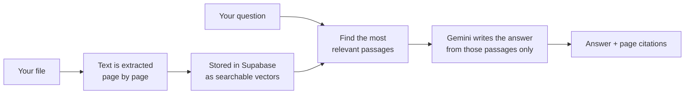

# DocuQuery

**Ask questions about your documents and get answers that show exactly where they come from.**

[Live demo](https://docuquery-backend-yx3z.onrender.com/) · [Demo video](docs/demo.mp4) · [Run it locally](#run-it-locally) · [Deploy](#deploy-on-render)

---

## What is DocuQuery?

DocuQuery is like a colleague who has read all of your documents. You add your files, ask a question in plain language, and it answers using **only what is written in them**, with the page each fact came from.

1. **Add** your files: PDFs (even scanned ones), Word, PowerPoint, Excel, CSV, text, images or a web page link.
2. **Ask** anything: "How many vacation days do new employees get?"
3. **Check** the answer: every answer lists its sources, and one click opens the exact page.

Your library is private to your account. You can also compare documents, group them in folders, and come back to old conversations at any time.

## Demo

<p align="center">
  
</p>
<p align="center">
  <a href="docs/demo.mp4">Watch in full quality (MP4, 90 seconds)</a>
</p>

## Features

- **Answers with citations:** every answer names the document and page it used, and opens it in a viewer.
- **Many file types:** PDF, Word, PowerPoint, Excel, CSV, text, Markdown, images and web pages. Scanned pages are read with OCR.
- **Smart search:** combines meaning-based and keyword search, so exact names and numbers are found too.
- **Compare documents:** pick 2 to 4 sources and ask how they differ.
- **Organise your library:** folders, tags, and a summary with suggested questions for every file.
- **Chat history:** reopen, rename, search, export (Markdown or PDF) and share conversations by link.
- **Personal settings:** English or French interface, light or dark theme, answer language, answer length and custom instructions.
- **Accounts:** sign up, reset password, export all your data, or delete your account.
- **Free and Pro plans:** Free accepts files up to 10 MB. Pro (50 MB files, more sources and questions) is a demo: upgrading is free and nothing is charged.

## How it works



| Part | Technology |
| :--- | :--- |
| Frontend | React 19, TypeScript, Vite |
| Backend | Python, FastAPI |
| Database and login | Supabase (PostgreSQL + pgvector, Supabase Auth, Storage) |
| AI | Google Gemini: `gemini-embedding-2` for search, `gemini-3.5-flash-lite` for answers |
| Hosting | Docker on Render |

## Run it locally

**You need:** Python 3.11+, Node.js 22+, a free [Supabase](https://supabase.com) project and a free [Gemini API key](https://aistudio.google.com/apikey).

**1. Prepare the database.** In Supabase, open **SQL Editor**, paste the whole of [`supabase_schema.sql`](supabase_schema.sql) and click **Run**. (Run it again after each update: it is safe to repeat.)

**2. Add your keys.** Copy `.env.example` to `.env` at the root of the project and fill in:

```env
GEMINI_API_KEY=your_gemini_api_key
SUPABASE_URL=https://your-project-id.supabase.co
SUPABASE_KEY=your_service_role_key
```

Use the **service_role** key from Supabase (Project Settings → API), not the anon key. The `.env` file stays on your computer and is never committed.

**3. Start the backend** (from the `backend` folder):

```bash
cd backend
python -m venv rag-env
rag-env\Scripts\activate          # macOS / Linux: source rag-env/bin/activate
pip install -r requirements.txt
uvicorn main:app --reload --port 8000
```

**4. Start the frontend** (in a second terminal):

```bash
cd frontend
npm install
npm run dev
```

Open **http://localhost:5173**, create an account and add your first file.

> Prefer Docker? Run `docker compose up --build` and open **http://localhost:8000**.

## Configuration

Only the three keys above are required. Everything else has a sensible default and is listed in [`.env.example`](.env.example).

| Variable | Default | What it does |
| :--- | :--- | :--- |
| `GENERATION_MODEL` | `gemini-3.5-flash-lite` | Gemini model that writes the answers |
| `MAX_UPLOAD_MB` | `10` | Largest file on the Free plan (Pro: `PRO_MAX_UPLOAD_MB`, 50) |
| `MAX_DOCS_PER_USER` | `25` | Sources per account on the Free plan |
| `DAILY_QUERY_LIMIT` | `200` | Questions per account per day on the Free plan |
| `BILLING_DEMO_MODE` | `true` | Lets users switch to the Pro demo for free; `false` turns it off |
| `ALLOWED_ORIGINS` | `*` | Only needed if the frontend is on another domain (e.g. Vercel) |
| `FRONTEND_URL` | — | Your site address, used in password-reset emails |

## Deploy on Render

The Docker image contains both the API and the website, so a single Render service is enough.

1. Push the project to GitHub.
2. In Supabase, run [`supabase_schema.sql`](supabase_schema.sql) in the SQL Editor.
3. On [Render](https://render.com), choose **New + → Blueprint** and select the repository. Render reads [`render.yaml`](render.yaml).
4. Enter `GEMINI_API_KEY`, `SUPABASE_URL` and `SUPABASE_KEY` (the same values as your `.env`), then click **Apply**.
5. When the service is **Live**, open `https://<your-service>.onrender.com/api/health`. It should show `{"status":"ok"}`.
6. In Supabase, go to **Authentication → URL Configuration** and set your Render address as the **Site URL** and in **Redirect URLs**.

To update, run the schema again if it changed, then `git push`: Render redeploys automatically.

**Common problems**

| Problem | Fix |
| :--- | :--- |
| Empty library or "schema is out of date" | Run `supabase_schema.sql` again |
| Signed in, but every request fails | `SUPABASE_KEY` must be the service_role key |
| First page load takes about 50 seconds | Normal on Render's free plan: the service was asleep |
| Old logo or page still showing | Refresh without cache (Ctrl + F5) |
| Confirmation or reset emails don't arrive | Add your own SMTP in Supabase (the built-in sender is for testing) |

## Tests

```bash
cd backend && python -m pytest          # API tests (no network or real keys needed)
cd frontend && npm test && npm run lint && npm run build
```

GitHub Actions runs them on every push ([`ci.yml`](.github/workflows/ci.yml)).

## Project structure

```
backend/
  main.py              FastAPI app
  routes/              API endpoints: auth, documents, query, chats, sharing, folders, account, plans
  services/            Text extraction, search, Gemini calls, database access, limits
  tests/               pytest suite
frontend/
  src/components/      Screens and panels (chat, library, settings, sign-in…)
  src/i18n/            English and French translations
supabase_schema.sql    Database tables, search function and security rules
Dockerfile             Builds the website and the API into one image
render.yaml            Render deployment blueprint
```

## Good to know

- **Privacy:** each user only ever sees their own documents and chats. On Gemini's free tier, Google may use the text it receives to improve its products; use a paid key for sensitive documents.
- **Pro is a demo:** there is no payment system. Anyone can switch their own account to Pro to try the higher limits.
- **Web pages that block readers** (some news sites, Reddit…): copy the text and use **Paste text**, or the **Add to DocuQuery** browser button from the same dialog.

## Author

Built by [Zaara Med Amin](https://github.com/zaaramedamin).
